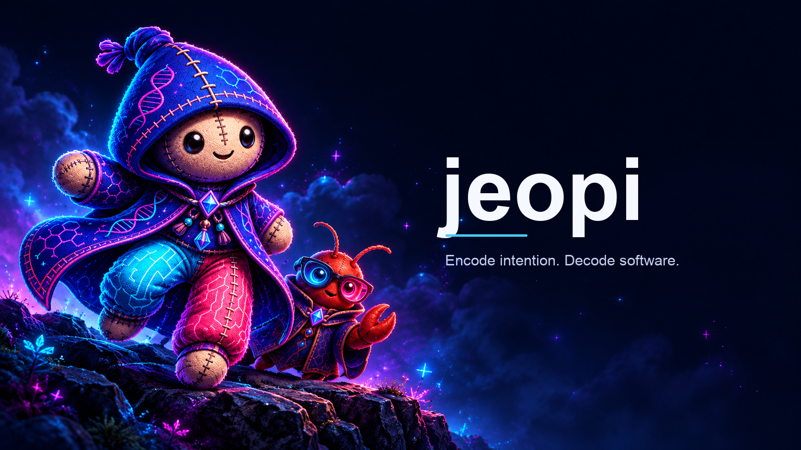
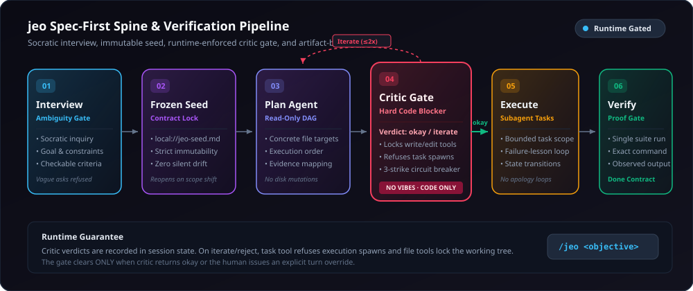
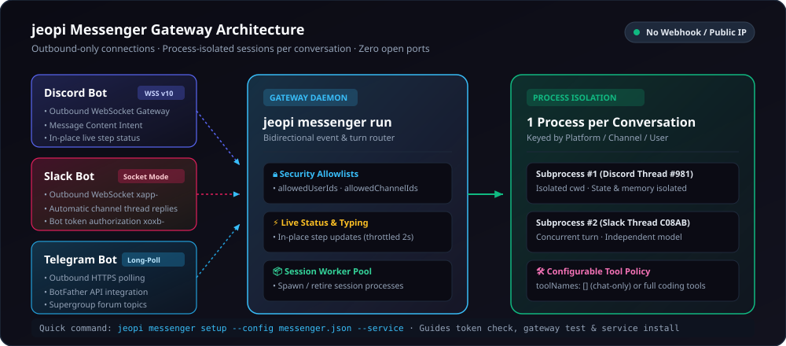
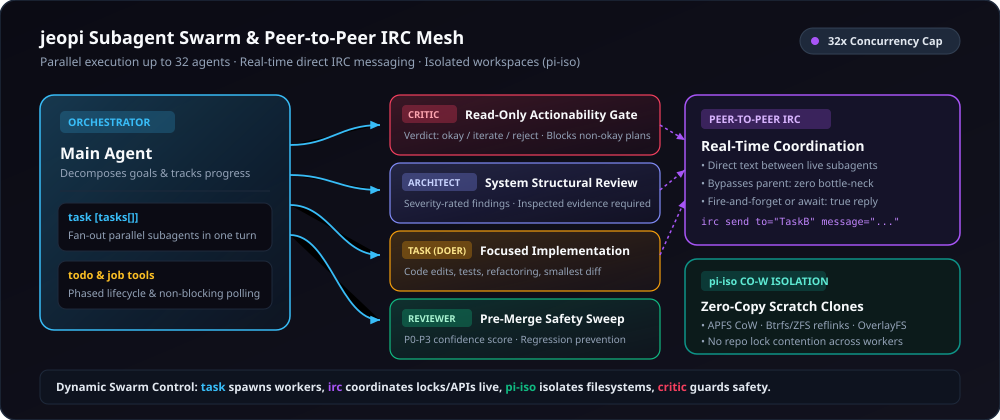

<h1 align="center">jeopi</h1>

<p align="center">
  
</p>

<p align="center">
  <strong>의도를 인코딩하고, 소프트웨어를 디코딩합니다.</strong><br>
  <em>통과하지 못한 게이트는 통과하지 못한 것으로 솔직하게 보고하는 스펙 우선 코딩 에이전트 엔진.</em>
</p>

<p align="center">
  언어: <a href="README.md">English</a> | <strong>한국어</strong>
</p>

<p align="center">
  <a href="https://github.com/akillness/jeopi"></a>
  
  
  
  
  <a href="packages/coding-agent/CHANGELOG.md"></a>
  <a href="LICENSE"></a>
  <a href="https://www.typescriptlang.org"></a>
  <a href="https://www.rust-lang.org"></a>
  <a href="https://bun.sh"></a>
  <a href="https://buymeacoffee.com/akillness3q"></a>
</p>

<p align="center">
  <strong>jeopi는 <a href="https://github.com/can1357/oh-my-pi">oh-my-pi</a>를 기반으로 확장된 고성능 터미널 코딩 에이전트 프로젝트입니다.</strong>
</p>

jeopi는 oh-my-pi의 강력한 인터랙티브 터미널 엔진을 기반으로, **런타임 강제 스펙 우선 파이프라인(`/jeo`)**, **멀티 플랫폼 메신저 게이트웨이(Discord · Slack · Telegram)**, **32개 병렬 P2P IRC 서브에이전트 메시**, **인프로세스 네이티브 Rust N-API 가속 레이어**를 결합하여 확장된 자율 엔지니어링 환경을 제공합니다.

---

## 🚀 설치 및 빠른 시작 (Installation & Quick Start)

### Bun (권장)

```sh
bun install -g jeopi-cli
jeopi --version
```

### npm

```sh
npm install -g jeopi-cli
```

### 소스코드 빌드 및 개발 환경 구축

```sh
git clone https://github.com/akillness/jeopi.git && cd jeopi
bun run setup   # 의존성 설치, Rust 네이티브 빌드, 전역 jeopi 심볼릭 링크 생성
```

> **업그레이드 안내**: 기존 `omp` 설정을 사용 중이었다면 `jeopi config migrate-legacy`를 실행하여 `~/.omp`의 인증, 세션, 설정 데이터를 `~/.jeopi`로 안전하게 이전할 수 있습니다.

### 첫 번째 세션 시작하기

임의의 프로젝트 폴더에서 `jeopi`를 실행합니다:

```sh
jeopi
```

- `/login`을 실행하여 Anthropic, OpenAI, Google, GitHub Copilot, Cursor 계정을 연동합니다.
- `/model`을 실행하여 40개 이상의 프론티어 및 로컬 모델 중 원하는 모델을 선택합니다.
- `/jeo <기능 설명>`을 입력하여 스펙 우선 파이프라인으로 자율 개발을 시작합니다.
- 터미널 쉘에서 비대화형 단일 쿼리 실행: `jeopi -p "이 저장소 구조를 분석해줘"`

### 쉘 자동 완성 (Shell Completions)

jeopi는 자체 CLI 메타데이터와 모델 카탈로그를 기반으로 완벽한 자동완성 스크립트를 동적으로 생성합니다:

```sh
# zsh (~/.zshrc 에 추가)
eval "$(jeopi completions zsh)"

# bash (~/.bashrc 에 추가)
eval "$(jeopi completions bash)"

# fish
jeopi completions fish > ~/.config/fish/completions/jeopi.fish
```

---

## ⚡ 주요 핵심 기능 (Core Capabilities)

- **스펙 우선 jeo 워크플로우 (`/jeo`)** — 모호성 인터뷰 → 불변 Seed 문서 → DAG 계획 → **런타임 강제 `critic` 게이트** (3회 제한 서킷 브레이커, 작업트리 쓰기 잠금) → 유한 실행 → 아티팩트 검증.
- **멀티 플랫폼 메신저 연동 (Discord · Slack · Telegram)** — 아웃바운드 WSS / 롱폴링 기반으로 **공인 IP · 방화벽 오픈 · 웹훅 · ngrok 없이** 봇 연결. 대화/스레드별 독립 프로세스 세션 격리 및 실시간 상태 라인 갱신.
- **1급 서브에이전트 & IRC 메시 (`task`, `irc`, `job`)** — 최대 32개 병렬 서브에이전트 팬아웃, 오케스트레이터 병목 없는 에이전트 간 직접 텍스트 통신(`irc`), `pi-iso` CoW 파일시스템 복제.
- **인프로세스 네이티브 Rust 가속 (`jeopi-natives`)** — `ripgrep`, `glob`, `brush` bash, `ast-grep`이 프로세스 내에서 직접 실행되어 fork-exec 오버헤드 0. macOS, Linux, Windows 네이티브 지원.
- **40개 이상의 프론티어 & 로컬 모델** — Claude 3.7 / Opus, GPT-5 / Codex, Gemini 2.5, xAI Grok, Ollama, LM Studio, vLLM을 단일 `/model` 명령어로 자유롭게 전환 및 폴백 체인 구성.

---

## 1. The Spec-First Spine (`/jeo` 워크플로우)

프롬프트 수준의 기대가 아닌, **런타임 코드로 강제되는 품질 게이트**를 갖춘 스펙 우선 개발 수명주기입니다:

```
/jeo <구현하고자 하는 목표나 기능>
```

<p align="center">
  
</p>

### 6단계 생명주기와 런타임 게이트

1. **소크라테스식 인터뷰 (Ambiguity Gate)**  
   모호한 지시("더 좋게 만들어줘", "알아서 고쳐줘")는 즉시 거부됩니다. 목표, 제약사항, 제외 범위, **기계적으로 검증 가능한 수락 기준(Checkable Acceptance Criteria)**을 확정하기 전까지 코드를 작성하지 않습니다.
2. **불변 Seed 문서 (`local://jeo-seed.md`)**  
   합의된 요구사항은 Seed 파일로 동결됩니다. 작업 진행 중 범위가 바뀌면 인터뷰가 다시 열리며, 임의로 스코프가 표류(silent drift)하지 않습니다.
3. **읽기 전용 Plan 에이전트**  
   대상 파일, 변경 순서, 기준별 검증 명령을 포함하는 구체적인 작업 DAG를 설계합니다. 이 단계에서는 디스크 쓰기가 일절 발생하지 않습니다.
4. **런타임 강제 `critic` 게이트 (Hard Code Blocker)**  
   독립된 `critic` 에이전트가 계획의 실현 가능성을 평가하여 `okay`, `iterate`, `reject` 판정을 내립니다.
   - **코드 레벨 강제**: 판정이 `okay`가 아니면 `task` 실행 서브에이전트 생성이 거부되고, `write`/`edit` 툴의 작업 트리 수정이 원천 차단됩니다.
   - **3-Strike 서킷 브레이커**: 3회 연속 비-okay 판정 시 계획 루프를 강제 중단하여 무한 루프를 방지합니다. 게이트는 계획이 통과하거나 사용자가 직접 새 입력을 보낼 때만 해제됩니다.
5. **유한 서브에이전트 실행 (Failure-Lesson Loop)**  
   단위별 `task` 에이전트가 격리된 환경에서 작업을 수행합니다. 실패 시 무의미한 사과나 재시도 대신, 무엇이 실패했는지를 다음 시도에 피드백하는 레슨 루프로 동작합니다.
6. **아티팩트 기반 단일 테스트 검증**  
   글로벌 테스트 스위트는 단 1회 실행되어 전체 무결성을 보장하며, 각 수락 기준마다 실행한 실제 명령과 관측된 결과를 명시해야만 작업이 완료됩니다.

---

## 2. Messenger Gateway (Discord, Slack, Telegram 메신저 연동)

사무실이나 이동 중에도 스마트폰 메신저를 통해 로컬/서버의 jeopi 세션과 실시간 양방향 대화 및 자율 작업을 수행할 수 있습니다.

<p align="center">
  
</p>

### Zero-Configuration 아웃바운드 아키텍처

- **방화벽 및 NAT 친화적 (No Inbound Ports)**  
  웹훅이나 공인 IP, 포트포워딩, ngrok 같은 터널링 도구가 전혀 필요 없습니다:
  - **Discord**: WSS Gateway v10 아웃바운드 연결 (`JEOPI_DISCORD_BOT_TOKEN`, Message Content Intent 필요).
  - **Slack**: Socket Mode WSS 아웃바운드 연결 (`xapp-...` 앱 토큰 + `xoxb-...` 봇 토큰).
  - **Telegram**: HTTPS 아웃바운드 롱폴링 (BotFather API 토큰).
- **대화별 프로세스 격리 (1 Process per Conversation)**  
  디스코드 스레드/DM, 슬랙 스레드, 텔레그램 채팅/토픽마다 **별도의 jeopi 세션 서브프로세스**가 생성됩니다. 대화 간 메모리, 세션 파일, 작업 디렉터리가 완벽히 분리됩니다.
- **실시간 진행 상태 표시 (Live Step Status)**  
  디스코드와 슬랙 스레드에서 도구 호출 내용(실행 명령, 파일 읽기 등)을 최대 2초 주기로 제자리(in-place) 갱신하여 현재 작업 단계를 한눈에 보여줍니다.
- **엄격한 보안 화이트리스트**  
  `allowedUserIds`와 `allowedChannelIds`를 지정하여 승인된 사용자 및 지정된 채널에서만 봇이 응답합니다.
- **도구 권한 제어 (`toolNames`)**  
  기본값은 순수 텍스트 챗봇(`toolNames: []`)이며, 필요에 따라 `bash`, `read`, `write`, `lsp`, `web_search` 등 코딩 툴 권한을 명시적으로 부여할 수 있습니다.

### 메신저 명령어 및 설정

```sh
# 설정 마법사: 토큰 검증, Message Content Intent 확인, 채널 선택 및 백그라운드 서비스 등록
jeopi messenger setup --config messenger.json --service

# 봇 연결 및 채널 상태 진단
jeopi messenger check --config messenger.json

# 메신저 게이트웨이 데몬 실행
jeopi messenger run --config messenger.json
```

**설정 파일 예시 (`messenger.json`)**:
```json
{
  "cwd": "./workspace",
  "sessionDir": "./sessions",
  "toolNames": ["read", "bash", "edit", "glob", "grep", "lsp"],
  "platforms": {
    "discord": {
      "tokenEnv": "JEOPI_DISCORD_BOT_TOKEN",
      "allowedUserIds": ["123456789012345678"],
      "allowedChannelIds": ["987654321098765432"]
    },
    "slack": {
      "tokenEnv": "JEOPI_SLACK_BOT_TOKEN",
      "appTokenEnv": "JEOPI_SLACK_APP_TOKEN",
      "allowedUserIds": ["U0123456789"],
      "allowedChannelIds": ["C0123456789"]
    },
    "telegram": {
      "tokenEnv": "JEOPI_TELEGRAM_BOT_TOKEN",
      "allowedUserIds": ["123456789"]
    }
  }
}
```

자세한 가이드는 [docs/messenger.md](docs/messenger.md), [docs/messenger/discord.md](docs/messenger/discord.md), [docs/messenger/slack.md](docs/messenger/slack.md), [docs/messenger/telegram.md](docs/messenger/telegram.md)를 참고하세요.

---

## 3. Subagent Swarm & Peer-to-Peer IRC Mesh

단일 에이전트의 컨텍스트 한계를 넘어, 세분화된 전문 에이전트들이 실시간으로 협력하는 **군집 오케스트레이션** 환경입니다.

<p align="center">
  
</p>

### 대규모 병렬 팬아웃 & P2P 통신

- **최대 32개 동시 실행 (`task` 툴)**  
  단일 턴에서 독립된 서브에이전트 배열을 한 번에 스폰하여 병렬로 처리합니다. 대규모 리팩토링, 멀티 모듈 조사, 병렬 코드 리뷰를 극도로 빠르게 완수합니다.
- **Main 병목 없는 직접 IRC 메시 (`irc` 툴)**  
  서브에이전트끼리 `irc send to="TaskB" message="..."`를 통해 실시간으로 락 상태, API 인터페이스, 중간 산출물을 주고받습니다. 오케스트레이터를 거치지 않아 지연과 컨텍스트 낭비가 없습니다.
- **Copy-on-Write 작업 공간 격리 (`pi-iso`)**  
  APFS 클론, Btrfs/ZFS 리플링크, OverlayFS를 활용하여 원본 작업트리를 오염시키지 않고 0초 만에 격리된 스크래치 워크스페이스를 생성하고 검증합니다.
- **전문 상주 에이전트 페르소나**  
  - `critic`: 읽기 전용 실행 게이트. 계획의 빈틈을 가차없이 지적.
  - `architect`: 심각도별 아키텍처 및 시스템 설계 감사.
  - `task`: 최소 단위의 변경으로 요구사항을 완수하는 주력 실행자.
  - `reviewer`: P0~P3 신뢰도 점수를 부여하는 보안/품질 리뷰어.
  - `advisor`: 별도 컨텍스트에서 메인 에이전트의 모든 턴을 감시하며 실시간 피드백 제공.

---

## 4. 내장 도구 및 네이티브 엔진 (Built-in Tools & Native Engine)

jeopi는 외부 CLI에 의존하지 않고 고성능 네이티브 구현체를 직접 내장하고 있습니다:

### 파일 및 코드 수정
- `read` — 파일, 디렉터리, tar/zip 압축파일, SQLite, PDF, Jupyter 노트북, URL 및 내부 URI(`pr://`, `issue://`, `agent://`, `skill://`)를 단일 인터페이스로 조회.
- `write` — 파일, 압축 엔트리, SQLite 행을 신규 생성 또는 원자적으로 덮어쓰기.
- `edit` — 줄 번호와 본문 해시 기반의 hashline 패치 (오프셋 드리프트 방지 및 충돌 복구).
- `ast_grep` — 50여 개 언어의 tree-sitter AST 구조 기반 구문 탐색.
- `ast_edit` — ast-grep 기반 안전한 구문 재작성 (적용 전 미리보기 지원).
- `grep` & `glob` — 인프로세스 Rust 정규식 파일 검색 및 고속 경로 글로빙.

### 런타임 및 실행 환경
- `bash` — 워크스페이스 셸 (PTY 지원, 백그라운드 작업, 영구 프로세스 유지).
- `eval` — 지속 상태를 유지하는 Python(IPython) 및 JavaScript(Bun) 커널 셀 (에이전트 도구 상호 호출 가능).
- `ssh` — 사전 구성된 원격 호스트 대상 단일 보안 명령 실행.

### 코드 인텔리전스
- `lsp` — 정의 이동, 참조 검색, 심볼 목록, 프로젝트 전반 심볼 이름 변경, 코드 액션 자동 적용.
- `debug` — DAP 프로토콜 디버거 드라이버 (브레이크포인트, 스텝 인/오버, 콜스택, 변수 스코프 검사).

### 에이전트 조율 및 협업
- `task` — 다중 서브에이전트 병렬 스폰 및 결과 비동기 수신.
- `irc` — 프로세스 내 활성 에이전트 간 직접 텍스트 메시지 송수신 및 대기.
- `todo` — 단계별(phase) 목표 추적 및 순차 완료 관리.
- `job` — 백그라운드 비동기 작업 모니터링 및 취소.
- `ask` — 사용자에게 구조화된 선택지 제시 및 분기 확인.

### 웹 & 브라우저
- `web_search` — 18개 백엔드(Perplexity, Gemini, Exa, Tavily 등) 자동 체인 검색 및 마크다운 정규화.
- `browser` — Chromium 탭 직접 제어 (DOM 추출, 접근성 트리 관측, 스크린샷, 상호작용).

---

## 5. 멀티 프로바이더 및 모델 에코시스템 (40+ Providers)

역할(Role)에 따른 지능적인 모델 라우팅을 지원합니다:
- `default`: 일상적인 개발 턴
- `smol`: 경량/저비용 서브에이전트 병렬 작업
- `slow`: 심층 추론 및 복잡한 아키텍처 판단
- `plan`: 계획 수립 모드

```sh
# 모델 지정 실행 예시
jeopi --model claude-3-7-sonnet
jeopi --model gpt-5 --smol gemini-2.5-flash
```

- **프론티어 API**: Anthropic Claude, OpenAI, OpenAI Codex, Google Gemini, Google Antigravity, xAI Grok, Mistral, Groq, Cerebras, OpenRouter 등.
- **코딩 플랜**: Cursor, GitHub Copilot, Kimi Code, MiniMax, Qwen, GLM, OpenCode 등.
- **로컬 셀프 호스팅**: Ollama, LM Studio, llama.cpp, vLLM, LiteLLM (키 없이 로컬 자동 갱신).
- **고급 라우팅**: 자동 폴백 체인(`retry.fallbackChains`), 경로별 모델 고정(path-scoped), 다계정 라운드로빈 API 키 로테이션.

---

## 6. 다양한 진입점 (Entry Points)

- **인터랙티브 TUI (`jeopi`)**: 차분하고 아름다운 터미널 차등 렌더링 UI. 도구 실행 카드, 실시간 스트리밍, `ask` 선택기.
- **원샷 모드 (`jeopi -p "명령"`)**: 단일 프롬프트를 처리하고 즉시 결과를 반환하는 CLI 파이프라인.
- **SDK 라이브러리 (`jeopi-cli`)**: Node.js/TypeScript 프로젝트 내에서 에이전트 세션을 직접 제어.
- **RPC 모드 (`jeopi --mode rpc`)**: 표준 입출력(stdio) NDJSON 프로토콜을 통해 다른 언어 프로세스에서 에이전트 구동.
- **ACP 모드 (`jeopi acp`)**: Zed 등 최신 에디터에서 Agent Client Protocol을 통해 에디터 버퍼 직접 조작.
- **라이브 협업 (`/collab`)**: 실시간 세션을 중계 서버에 올려 URL과 QR 코드로 동료와 페어 프로그래밍.
- **메신저 게이트웨이 (`jeopi messenger`)**: Discord, Slack, Telegram을 통한 원격 헤드리스 세션 연동.

---

## 7. 모노레포 패키지 구성 (Monorepo Packages)

| Package | Description |
|---|---|
| **[jeopi-cli](packages/coding-agent)** | 터미널 코딩 에이전트 CLI, SDK, 메신저 게이트웨이 통합 패키지 |
| **[jeopi-agent-core](packages/agent)** | 도구 호출 및 상태 머신을 담당하는 코어 런타임 |
| **[jeopi-ai](packages/ai)** | 멀티 프로바이더 LLM 스트리밍 클라이언트 |
| **[jeopi-catalog](packages/catalog)** | 모델 카탈로그, 프로바이더 디스크립터 및 추론 정책 관리 |
| **[jeopi-tui](packages/tui)** | 터미널 차등 렌더링 TUI 컴포넌트 라이브러리 |
| **[jeopi-natives](packages/natives)** | grep, shell, AST, 이미지 연산용 고속 N-API 바인딩 |
| **[jeopi-stats](packages/stats)** | 로컬 AI 사용량 통계 대시보드 (`jeopi stats`) |
| **[jeopi-utils](packages/utils)** | 파일, 로깅, 스트림, 프로세스 공통 유틸리티 |
| **[jeopi-collab-web](packages/collab-web)** | Collab 실시간 웹 게스트 클라이언트 및 릴레이 |
| **[jeopi-hashline](packages/hashline)** | 해시 기반 라인 패치 및 충돌 복구 언어 |
| **[jeopi-wire](packages/wire)** | Collab 및 RPC 세션 통신 프로토콜 정의 |
| **[jeopi-mnemopi](packages/mnemopi)** | SQLite 기반 영구 메모리 엔진 |
| **[jeopi-snapcompact](packages/snapcompact)** | 비트맵 프레임 컨텍스트 압축 엔진 |
| **[jeopi-swarm-extension](packages/swarm-extension)** | Swarm 분산 에이전트 확장 패키지 |

### Rust 크레이트 (`crates/`)

| Crate | Description |
|---|---|
| **[pi-natives](crates/pi-natives)** | Rust 코어 N-API `cdylib` 네이티브 모듈 |
| **[pi-shell](crates/pi-shell)** | PTY 및 프로세스 관리를 위한 임베디드 셸 엔진 |
| **[pi-ast](crates/pi-ast)** | 50개 이상 언어의 tree-sitter AST 파서 및 코드 요약기 |
| **[pi-iso](crates/pi-iso)** | APFS CoW, Btrfs/ZFS reflink, OverlayFS 기반 파일시스템 격리 엔진 |

---

## 변경 이력 (Changelog)

<!-- CHANGELOG:START (auto-generated from packages/coding-agent/CHANGELOG.md — run `bun run gen:readme-changelog`) -->
Latest 5 released entries:
- **[16.6.18]** (2026-11-03) — Messenger requests now show a single refreshable progress line in Telegram topics and Slack threads as well as Discord threads, and remove it when the turn finishes.
- **[16.6.17]** (2026-11-03) — New messenger sessions use the configured default model, while resumed sessions retain their previous model.
- **[16.6.15]** (2026-11-02) — `jeopi messenger setup --config <file> [--service]` sets up a Discord bot from its token: it verifies the token, enables the Message Content Intent through the API when allowed, allowlists the…
- **[16.6.14]** (2026-10-30) — `jeopi messenger run` gives every conversation (a Discord request thread or DM, a Telegram chat or topic, a Slack thread) its own jeopi session process, so separate conversations are answered…
- **[16.6.13]** (2026-10-30) — Discord requests in the messenger gateway and `/discord live` show one in-place status line with the current step (the tool call's declared intent or tool name), edited at most every 2 seconds and…

전체 변경 내역은 [packages/coding-agent/CHANGELOG.md](packages/coding-agent/CHANGELOG.md)를 확인하세요.
<!-- CHANGELOG:END -->

---

## 라이선스 및 크레딧 (License & Attribution)

- **License**: MIT License. See [LICENSE](LICENSE).
- **Lineage**:
  - Based on and extended from [oh-my-pi](https://github.com/can1357/oh-my-pi) by [Can Bölük](https://github.com/can1357).
  - Derived from [Pi](https://github.com/badlogic/pi-mono) by [Mario Zechner](https://github.com/mariozechner).
  - Spec-first engineering discipline and runtime gates inspired by [jeo-code](https://github.com/akillness/jeo-code).

© 2025 Mario Zechner  
© 2025–2026 Can Bölük  
© 2026 jeopi contributors

_Encode intention. Decode software._
