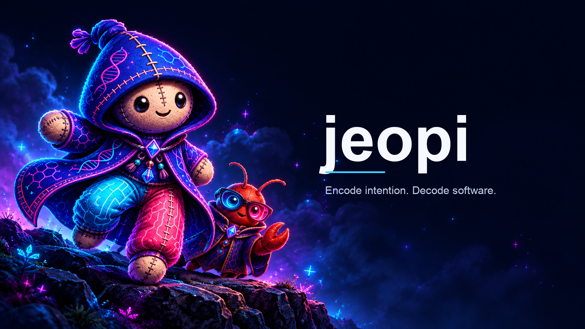
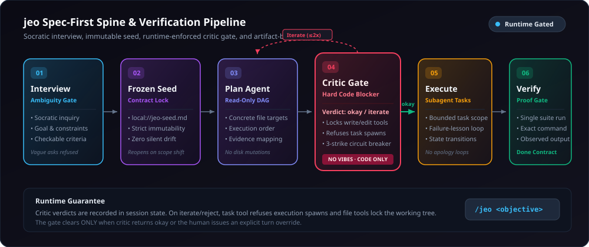
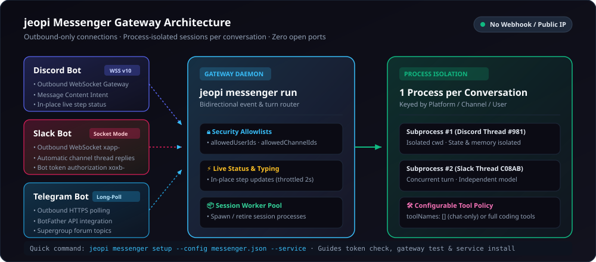
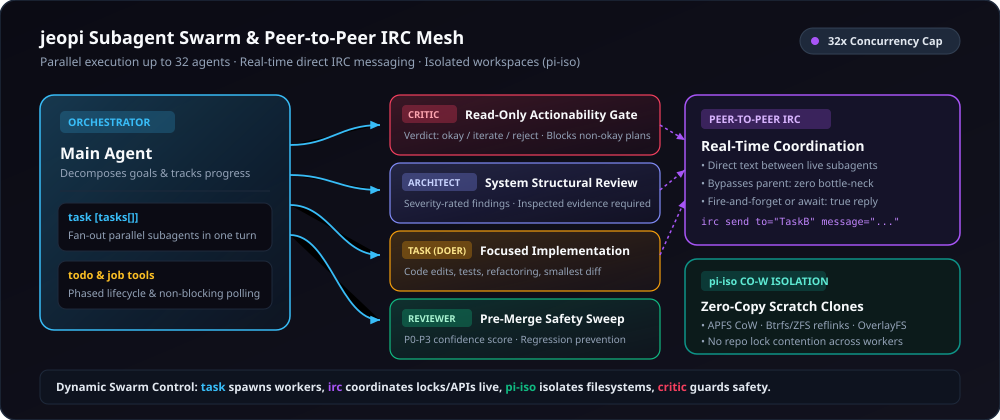

<h1 align="center">jeopi</h1>

<p align="center">
  
</p>

<p align="center">
  <strong>Encode intention. Decode software.</strong><br>
  <em>A spec-first coding agent engine where a gate that didn't pass is reported as not passed.</em>
</p>

<p align="center">
  Language: <strong>English</strong> | <a href="README.ko.md">한국어</a>
</p>

<p align="center">
  <a href="https://github.com/akillness/jeopi"></a>
  
  
  
  
  <a href="packages/coding-agent/CHANGELOG.md"></a>
  <a href="LICENSE"></a>
  <a href="https://www.typescriptlang.org"></a>
  <a href="https://www.rust-lang.org"></a>
  <a href="https://bun.sh"></a>
  <a href="https://buymeacoffee.com/akillness3q"></a>
</p>

<p align="center">
  <strong>jeopi is an extended, production-grade coding agent project built upon <a href="https://github.com/can1357/oh-my-pi">oh-my-pi</a>.</strong>
</p>

jeopi combines oh-my-pi's high-performance interactive terminal engine with a **runtime-enforced spec-first pipeline (`/jeo`)**, **multi-platform messenger gateways (Discord · Slack · Telegram)**, a **32-way parallel P2P IRC subagent mesh**, and an **in-process native Rust N-API layer** to provide a disciplined, autonomous engineering environment.

---

## 🚀 Installation & Quick Start

### Bun (Recommended)

```sh
bun install -g jeopi-cli
jeopi --version
```

### npm

```sh
npm install -g jeopi-cli
```

### Build from Source

```sh
git clone https://github.com/akillness/jeopi.git && cd jeopi
bun run setup   # Installs dependencies, builds native addons, links global jeopi CLI
```

> **Upgrading from `omp`?** Run `jeopi config migrate-legacy` to safely move your auth tokens, sessions, and settings from `~/.omp` to `~/.jeopi`.

### Your First Session

Launch `jeopi` in any project directory:

```sh
jeopi
```

- Run `/login` to authenticate with Anthropic, OpenAI, Google, GitHub Copilot, or Cursor.
- Run `/model` to select from 40+ frontier and local model providers.
- Run `/jeo <feature>` to execute with the spec-first pipeline.
- For a single one-shot query from your shell: `jeopi -p "explain this repository"`

### Shell Completions

jeopi generates live completion scripts for **bash**, **zsh**, and **fish** dynamically from CLI metadata:

```sh
# zsh (add to ~/.zshrc)
eval "$(jeopi completions zsh)"

# bash (add to ~/.bashrc)
eval "$(jeopi completions bash)"

# fish
jeopi completions fish > ~/.config/fish/completions/jeopi.fish
```

---

## ⚡ Core Capabilities

- **Spec-First jeo Workflow (`/jeo`)** — Socratic ambiguity gate → immutable frozen seed → DAG planning → **runtime-enforced `critic` gate** (3-strike circuit breaker, working-tree write lock) → bounded execution → artifact-backed single suite verification.
- **Multi-Platform Messenger Gateway (Discord · Slack · Telegram)** — Connect bots with **no public IP, no open ports, no webhooks, and no ngrok tunnels** via outbound WSS / HTTPS long-polling. Includes per-conversation process isolation and live in-place status line updates.
- **First-Class Subagent Swarm & IRC Mesh (`task`, `irc`, `job`)** — Fan out up to 32 parallel subagents, coordinate directly via zero-bottleneck peer-to-peer prose messaging (`irc`), and leverage CoW filesystem clones (`pi-iso`).
- **In-Process Native Rust Acceleration (`jeopi-natives`)** — Embedded `ripgrep`, `glob`, `brush` bash, and `ast-grep` run directly in-process with zero fork-exec overhead across macOS, Linux, and Windows.
- **40+ Frontier & Local Models** — Fluidly route turns to Claude 3.7 / Opus, GPT-5 / Codex, Gemini 2.5, xAI Grok, Ollama, LM Studio, or vLLM with path-scoped configs and automatic fallback chains.

---

## 1. The Spec-First Spine (`/jeo` Workflow)

A disciplined engineering lifecycle where quality gates are enforced by **runtime code, not prompt vibes**:

```
/jeo <what you want built>
```

<p align="center">
  
</p>

### 6-Stage Lifecycle & Runtime Gates

1. **Socratic Interview (Ambiguity Gate)**  
   Vague asks ("make it better", "fix everything") are strictly refused. The agent extracts goals, invariants, explicit non-goals, and **mechanically checkable acceptance criteria** before writing a single line of code.
2. **Immutable Frozen Seed (`local://jeo-seed.md`)**  
   Agreed requirements freeze into an immutable seed file. If scope shifts during implementation, the interview reopens explicitly rather than silently drifting.
3. **Read-Only Plan Agent**  
   The `plan` specialist designs a concrete dependency DAG specifying exact target files, sequencing, and per-criterion verification commands. No disk mutations occur at this stage.
4. **Runtime-Enforced `critic` Gate (Hard Code Blocker)**  
   An independent `critic` agent reviews the plan and emits a schema-validated verdict: `okay`, `iterate`, or `reject`.
   - **Runtime Lock**: If the verdict is not `okay`, the `task` tool refuses to spawn execution subagents, and `write`/`edit` tools lock the working tree against modifications.
   - **3-Strike Circuit Breaker**: Three consecutive non-okay verdicts trip a circuit breaker, halting execution to prevent infinite planning loops. The gate clears only when a plan earns an `okay` or the user intervenes with a manual message.
5. **Bounded Execution (Failure-Lesson Loop)**  
   Scoped `task` subagents execute isolated work units. When a task fails, it feeds what was learned into the next attempt rather than repeating the same failed pattern.
6. **Artifact-Backed Verification**  
   The global test suite runs exactly once at the end. Every acceptance criterion must cite its executed command and observed output to be marked complete.

---

## 2. Messenger Gateway (Discord, Slack, Telegram)

Interact with your local or remote jeopi agent sessions anywhere from your phone or desktop chat apps with full bidirectional capabilities.

<p align="center">
  
</p>

### Zero-Configuration Outbound Architecture

- **Firewall & NAT Friendly (No Inbound Ports)**  
  Zero webhooks, zero public IPs, zero port forwarding, and no reverse-tunnel services (like ngrok) are required:
  - **Discord**: Outbound WebSocket Gateway v10 (`JEOPI_DISCORD_BOT_TOKEN`) with Message Content Intent.
  - **Slack**: Outbound WebSocket Socket Mode (`xapp-...` app token + `xoxb-...` bot token).
  - **Telegram**: Outbound HTTPS long-polling via BotFather token.
- **Process Isolation (1 Process per Conversation)**  
  Every Discord thread/DM, Slack thread, or Telegram chat/topic runs in **its own dedicated jeopi session subprocess**. Working directories, session state, and conversation histories are completely isolated.
- **Live In-Place Step Status Updates**  
  The agent edits a single status line in Discord and Slack threads in real time (throttled to 2 seconds) showing declared intent and tool activity as work happens.
- **Strict Security Allowlists**  
  `allowedUserIds` and `allowedChannelIds` ensure bots respond only to authorized users in designated channels.
- **Configurable Tool Policies (`toolNames`)**  
  Defaults to pure conversation (`toolNames: []`). Coding tools (`bash`, `read`, `write`, `lsp`, `web_search`) must be explicitly whitelisted.

### Messenger CLI Commands

```sh
# Interactive setup wizard: validates tokens, enables intents, invites bot, and installs background service
jeopi messenger setup --config messenger.json --service

# Verify connection, permissions, and channel allowlists
jeopi messenger check --config messenger.json

# Run the messenger gateway daemon
jeopi messenger run --config messenger.json
```

**Configuration Example (`messenger.json`)**:
```json
{
  "cwd": "./workspace",
  "sessionDir": "./sessions",
  "toolNames": ["read", "bash", "edit", "glob", "grep", "lsp"],
  "platforms": {
    "discord": {
      "tokenEnv": "JEOPI_DISCORD_BOT_TOKEN",
      "allowedUserIds": ["123456789012345678"],
      "allowedChannelIds": ["987654321098765432"]
    },
    "slack": {
      "tokenEnv": "JEOPI_SLACK_BOT_TOKEN",
      "appTokenEnv": "JEOPI_SLACK_APP_TOKEN",
      "allowedUserIds": ["U0123456789"],
      "allowedChannelIds": ["C0123456789"]
    },
    "telegram": {
      "tokenEnv": "JEOPI_TELEGRAM_BOT_TOKEN",
      "allowedUserIds": ["123456789"]
    }
  }
}
```

Detailed guides: [docs/messenger.md](docs/messenger.md) · [Discord Guide](docs/messenger/discord.md) · [Slack Guide](docs/messenger/slack.md) · [Telegram Guide](docs/messenger/telegram.md).

---

## 3. Subagent Swarm & Peer-to-Peer IRC Mesh

Break large coding tasks into parallel work streams without the context bloat and sequential bottlenecks of single-agent loops.

<p align="center">
  
</p>

### Large-Scale Fan-Out & Direct P2P Messaging

- **Up to 32 Parallel Subagents (`task` tool)**  
  Dispatch an entire batch of specialist agents concurrently in a single turn. Results deliver asynchronously upon completion.
- **Zero-Bottleneck Inter-Agent Communication (`irc` tool)**  
  Subagents message each other directly via `irc send to="TaskB" message="..."` to coordinate shared file locks, API contracts, and findings without waiting on the main orchestrator.
- **Copy-on-Write Task Isolation (`pi-iso`)**  
  Uses instant APFS clones (macOS), Btrfs/ZFS reflinks, or Linux OverlayFS to give subagents zero-copy scratch spaces that never cause working-tree conflicts.
- **Specialized Standing Personas**  
  - `critic`: Read-only actionability gate for vetting plans.
  - `architect`: Severity-rated system structure and contract audits.
  - `task`: Focused executor making the smallest correct changes.
  - `reviewer`: Post-implementation patch security and standards reviewer.
  - `advisor`: Second model observing every turn in the background.

---

## 4. Built-in Tools & Native Engine

jeopi links high-performance implementations directly into the runtime instead of shelling out to system utilities:

### Files & Code Manipulation
- `read` — Unified reader for files, directories, tar/zip archives, SQLite, PDFs, Jupyter notebooks, URLs, and internal schemes (`pr://`, `issue://`, `agent://`, `skill://`).
- `write` — Create or overwrite files, archive entries, or SQLite rows atomically.
- `edit` — Hashline patch applier with content-hash anchors and automatic collision recovery.
- `ast_grep` — Structural AST code search across 50+ language grammars via tree-sitter.
- `ast_edit` — Structural syntax rewrites with preview before apply.
- `grep` & `glob` — In-process Rust regex search and fast path matching.

### Runtime & Execution
- `bash` — Workspace shell with persistent sessions, PTY support, and background execution.
- `eval` — Persistent stateful Python (IPython) and JavaScript (Bun) kernels with shared tool bridge.
- `ssh` — Execute commands on remote SSH targets.

### Code Intelligence
- `lsp` — Diagnostics, hover, go-to-definition, find-references, workspace renames, and auto-applying code actions.
- `debug` — DAP debugger driver (breakpoints, stepping, stack frames, variable scopes).

### Swarm & Coordination
- `task` — Fan out parallel subagents with asynchronous result delivery.
- `irc` — Direct peer-to-peer messaging between concurrent agents in the process.
- `todo` — Phased task tracking with automatic status promotion.
- `job` — Lifecycle control for background tasks.
- `ask` — Present structured option pickers to the user during interactive turns.

### Web & Browser
- `web_search` — 18-provider automated search chain (Perplexity, Gemini, Exa, Tavily, etc.) returning structured Markdown with citation anchors.
- `browser` — Puppeteer-controlled Chromium tabs over headless instances or CDP-attached desktop apps.

---

## 5. Multi-Provider & Model Ecosystem (40+ Providers)

Intelligent model routing tailored by task intent:
- `default`: General interactive turns.
- `smol`: Low-cost, fast subagent fan-out.
- `slow`: Deep analytical reasoning.
- `plan`: Architectural design and decomposition.

```sh
# Launch with explicit models
jeopi --model claude-3-7-sonnet
jeopi --model gpt-5 --smol gemini-2.5-flash
```

- **Frontier APIs**: Anthropic Claude, OpenAI, OpenAI Codex, Google Gemini, Google Antigravity, xAI Grok, Mistral, Groq, Cerebras, OpenRouter, etc.
- **Coding Plans**: Cursor, GitHub Copilot, Kimi Code, MiniMax, Qwen, GLM, OpenCode, etc.
- **Local Self-Hosted**: Ollama, LM Studio, llama.cpp, vLLM, LiteLLM (dynamic local discovery, keyless by default).
- **Advanced Routing**: Fallback chains (`retry.fallbackChains`), path-scoped model pins, multi-credential round-robin rotation.

---

## 6. Entry Points

- **Interactive TUI (`jeopi`)**: Differential terminal rendering, tool execution cards, live token reveals, and structured pickers.
- **One-Shot CLI (`jeopi -p "prompt"`)**: Process a prompt non-interactively and pipe clean output.
- **SDK (`jeopi-cli`)**: Embed session management directly into Node.js/TypeScript applications.
- **RPC Mode (`jeopi --mode rpc`)**: Stdio-based NDJSON protocol for driving jeopi from any programming language.
- **ACP Mode (`jeopi acp`)**: Direct Agent Client Protocol integration for editors like Zed.
- **Live Pair Programming (`/collab`)**: Share active sessions via encrypted relays with a browser URL and QR code.
- **Messenger Gateway (`jeopi messenger`)**: Drive headless agent sessions via Discord, Slack, and Telegram.

---

## 7. Monorepo Packages

| Package | Description |
|---|---|
| **[jeopi-cli](packages/coding-agent)** | Interactive coding agent CLI, SDK, and Messenger Gateway |
| **[jeopi-agent-core](packages/agent)** | Agent core runtime, tool dispatch, and state machine |
| **[jeopi-ai](packages/ai)** | Multi-provider streaming LLM client |
| **[jeopi-catalog](packages/catalog)** | Model catalog, provider descriptors, and thinking policies |
| **[jeopi-tui](packages/tui)** | Differential terminal rendering component library |
| **[jeopi-natives](packages/natives)** | N-API bindings for in-process grep, shell, AST, and image operations |
| **[jeopi-stats](packages/stats)** | Local token usage and cost analytics dashboard (`jeopi stats`) |
| **[jeopi-utils](packages/utils)** | Shared utilities (file I/O, logging, streams, process helpers) |
| **[jeopi-collab-web](packages/collab-web)** | Web client and local relay for live collaborative pairing |
| **[jeopi-hashline](packages/hashline)** | Content-hash line patch language behind `edit` |
| **[jeopi-wire](packages/wire)** | Collab session protocol types and constants |
| **[jeopi-mnemopi](packages/mnemopi)** | SQLite memory engine for persistent project recall |
| **[jeopi-snapcompact](packages/snapcompact)** | Bitmap-frame context compression engine |
| **[jeopi-swarm-extension](packages/swarm-extension)** | Distributed swarm orchestration extension |

### Rust Crates (`crates/`)

| Crate | Description |
|---|---|
| **[pi-natives](crates/pi-natives)** | Rust core N-API `cdylib` addon aggregating the native engine |
| **[pi-shell](crates/pi-shell)** | Embedded PTY and brush-based shell engine |
| **[pi-ast](crates/pi-ast)** | Tree-sitter AST parser across 50+ languages |
| **[pi-iso](crates/pi-iso)** | Task isolation resolver (APFS CoW, Btrfs/ZFS reflinks, OverlayFS) |

---

## Changelog

<!-- CHANGELOG:START (auto-generated from packages/coding-agent/CHANGELOG.md — run `bun run gen:readme-changelog`) -->
Latest 5 released entries:
- **[16.6.23]** (2026-11-13) — Updated interrupted-turn regression coverage to preserve native thinking in session history without copying it into hidden plaintext context for official Anthropic requests.
- **[16.6.22]** (2026-11-13) — Prevented legacy interrupted private reasoning from entering official Anthropic main and side requests. Unrepairable `reasoning_extraction` refusals now retain their original diagnostic and stop…
- **[16.6.18]** (2026-11-03) — Messenger requests now show a single refreshable progress line in Telegram topics and Slack threads as well as Discord threads, and remove it when the turn finishes.
- **[16.6.17]** (2026-11-03) — New messenger sessions use the configured default model, while resumed sessions retain their previous model.
- **[16.6.15]** (2026-11-02) — `jeopi messenger setup --config <file> [--service]` sets up a Discord bot from its token: it verifies the token, enables the Message Content Intent through the API when allowed, allowlists the…

See [packages/coding-agent/CHANGELOG.md](packages/coding-agent/CHANGELOG.md) for the full history.
<!-- CHANGELOG:END -->

---

## License & Attribution

- **License**: MIT License. See [LICENSE](LICENSE).
- **Lineage**:
  - Based on and extended from [oh-my-pi](https://github.com/can1357/oh-my-pi) by [Can Bölük](https://github.com/can1357).
  - Derived from [Pi](https://github.com/badlogic/pi-mono) by [Mario Zechner](https://github.com/mariozechner).
  - Spec-first engineering discipline and runtime gates inspired by [jeo-code](https://github.com/akillness/jeo-code).

© 2025 Mario Zechner  
© 2025–2026 Can Bölük  
© 2026 jeopi contributors

_Encode intention. Decode software._
